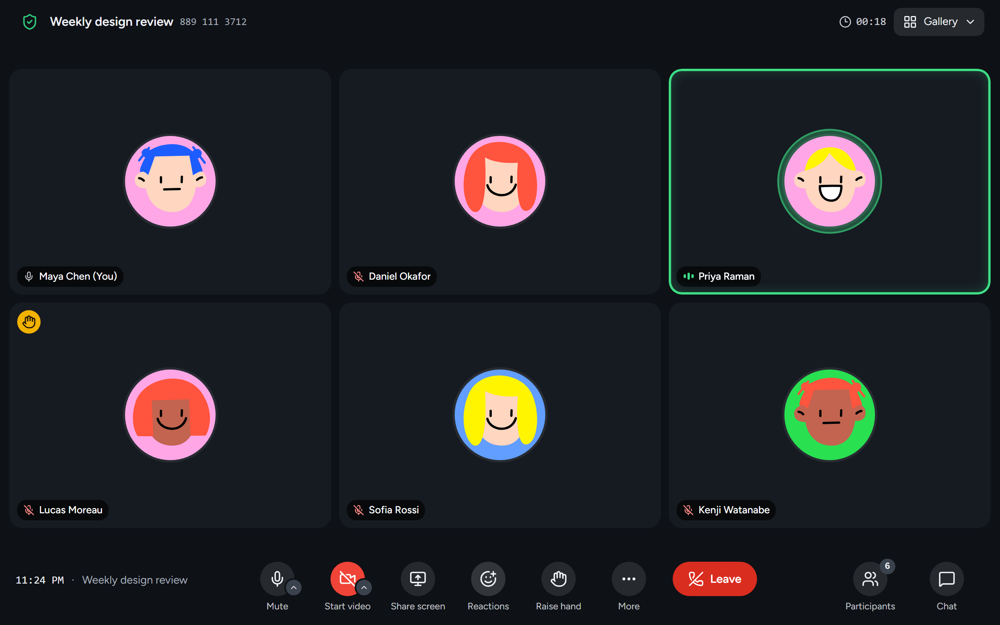

<div align="center">

<picture>
  <source media="(prefers-color-scheme: dark)" srcset="public/brand/logo-mark-dark.svg">
  
</picture>

# FaceOn Meetings

**Free, open-source video meetings that run in your browser.**

[](https://github.com/donth77/faceon-meetings/releases)
[](LICENSE)
[](https://nextjs.org)
[](https://react.dev)
[](https://www.typescriptlang.org)



</div>

---

Try it at [joinfaceon.app](https://joinfaceon.app), or [deploy your own](#deploy-your-own).

## What works

- Instant and scheduled meetings, and a personal room
- Join by link or meeting ID; guests need only a name
- Passcodes, a waiting room and host controls
- Chat, reactions, raised hands and screen sharing
- Background blur, backgrounds and noise suppression
- Google Calendar invitations and meeting reminders
- AI notes, if you want them
- Previous meetings, attendance and your data to download
- A [desktop app](desktop/README.md) for Windows and Mac
- FaceOn in [Google Calendar and Gmail](google-addon/README.md)
- In English, Spanish, Portuguese (Brazil), French, German and Japanese

## Tech stack

- [Next.js](https://nextjs.org) 16 (App Router, TypeScript) on [Vercel](https://vercel.com)
- [Tailwind CSS](https://tailwindcss.com) 4 and [shadcn/ui](https://ui.shadcn.com), with [Lucide](https://lucide.dev) icons
- [Stream Video](https://getstream.io/video/) for media
- [Better Auth](https://www.better-auth.com) for accounts, [Neon](https://neon.com) Postgres and [Drizzle ORM](https://orm.drizzle.team)
- [Electron](https://www.electronjs.org) for the desktop app

## Run it locally

Requirements: Node.js 24 and pnpm 10.

```bash
pnpm install
cp .env.example .env.local   # then fill in the values you need
pnpm dev                     # http://localhost:3000
```

Accounts: Google, GitHub, or email and password. Locally, email sign-up works without an email service: the verification and password-reset emails print in the dev server's log, links included.

Useful scripts:

| Command          | What it does                                             |
| ---------------- | -------------------------------------------------------- |
| `pnpm dev`       | Start the dev server                                     |
| `pnpm build`     | Production build                                         |
| `pnpm lint`      | ESLint                                                   |
| `pnpm typecheck` | Generate route types, then run the TypeScript compiler   |
| `pnpm test`      | Unit tests (Vitest)                                      |
| `pnpm test:e2e`  | Browser tests (Playwright) against `pnpm build`'s output |
| `pnpm format`    | Format with Prettier                                     |

The desktop app and the Google add-on have their own guides: [desktop/DEVELOPING.md](desktop/DEVELOPING.md) and [google-addon/DEVELOPING.md](google-addon/DEVELOPING.md).

## Deploy your own

FaceOn runs on free plans. [DEPLOY.md](DEPLOY.md) walks through every step, from the accounts to your own domain.

| For             | Service                                 |
| --------------- | --------------------------------------- |
| Hosting         | [Vercel](https://vercel.com)            |
| Database        | [Neon](https://neon.com)                |
| Audio and video | [Stream](https://getstream.io)          |
| Sign-in         | Google and GitHub                       |
| Email sign-in   | [Resend](https://resend.com) (optional) |

Optional:

- **Protect and watch:** bot checks, error reports, uptime checks and encrypted backups. See [Protect and watch your copy](DEPLOY.md#protect-and-watch-your-copy-optional).
- **Make it yours:** your own name, logo and colors. See [Make it yours](DEPLOY.md#make-it-yours).
- **Apps:** [Desktop app](DEPLOY.md#the-desktop-app-optional) and the [Google Workspace add-on](DEPLOY.md#the-google-workspace-add-on-optional).
